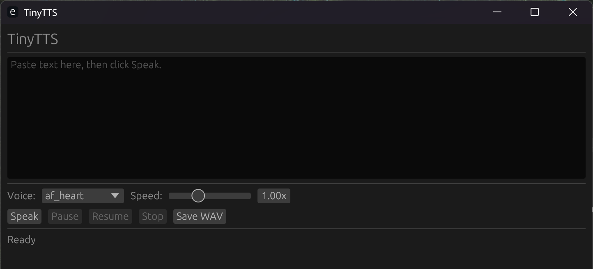

# TinyTTS

Offline text-to-speech for Windows using Rust, sherpa-onnx and Kokoro.

[简体中文](README.zh-CN.md) · [Architecture](docs/architecture.md) · [Issues](https://github.com/styayur/TinyTTS/issues)

**Source preview.** No GitHub release is published as of 22-10-2026. Build from source; a release workflow and packaging instructions are not an available download.



## Features

Chinese, English and mixed-text reading; segmented long text; Speak / Pause / Resume / Stop; voice selection; speed 0.5–2.0; 16-bit PCM WAV export. `Ctrl+Alt+S` reads the Windows clipboard while the app is running. Settings live beside the executable. A bounded audio queue limits queued audio.

Inference is local, without an account, telemetry or HTTP server. Python/Node.js are not runtime requirements. Source builds and the initial manual model download require network access.

## Build and first run

Use Windows 10/11 x64, stable Rust with the `x86_64-pc-windows-msvc` target, and Visual Studio Build Tools with **Desktop development with C++** and a Windows SDK. GNU Rust is not sufficient for the default prebuilt native library. The sherpa-onnx build script downloads that library on the first native build.

```powershell
git clone https://github.com/styayur/TinyTTS.git
cd TinyTTS
rustc -vV
cargo build --release
```

Confirm `rustc -vV` reports the MSVC host. The executable is `target/release/TinyTTS.exe`. Work in that directory for model setup:

```powershell
Set-Location ./target/release
```

Download the pinned model, verify its hash **before extraction**, and inspect its paths:

```powershell
New-Item -ItemType Directory -Force models | Out-Null
curl.exe -L -o kokoro.tar.bz2 https://github.com/k2-fsa/sherpa-onnx/releases/download/tts-models/kokoro-multi-lang-v1_0.tar.bz2
$expected = 'C5F7E2D2CAF082BC1D20FB70334A61D99D20B484500AAD32E7CF84C128EA3298'
if ((Get-FileHash ./kokoro.tar.bz2 -Algorithm SHA256).Hash -ne $expected) { throw 'Model checksum mismatch' }
tar -tf ./kokoro.tar.bz2 | Select-Object -First 15
tar -xf ./kokoro.tar.bz2 -C ./models
```

The archive includes a model directory. Rename that extracted directory to `models/kokoro` without replacing an existing model, or set `model_dir` to its absolute path. Merely extracting beside the EXE does not establish the default layout. Preserve the complete model contents, including lexicons and dictionary data:

```text
TinyTTS.exe
models/kokoro/
  model.onnx
  voices.bin
  tokens.txt
  espeak-ng-data/
  lexicon-us-en.txt
  lexicon-zh.txt
  dict/
config/config.toml   # created when settings are saved
```

The model archive is 349,906,910 bytes and has separate component terms; see [provenance](docs/model-provenance.md) and [third-party notices](THIRD_PARTY_NOTICES.md). The app never downloads models at runtime. A missing-model error lists the path searched.

```powershell
.\TinyTTS.exe
```

Wait for `Loading model...` to become `Ready`, paste text and press Speak. Pause/Resume controls playback; Stop clears queued audio and cancels generation. Save WAV renders the full text to a mono PCM WAV. The global shortcut reads clipboard text, so check clipboard contents before using it.

## Configuration

Copy the root [config.example.toml](config.example.toml) to `config/config.toml` beside the EXE for manual configuration, or save voice/speed in the UI.

| Key | Default | Meaning |
| --- | --- | --- |
| `voice` | `af_heart` | A voice present in the selected model |
| `speed` | `1.0` | 0.5–2.0 playback speed |
| `num_threads` | `2` | 1, 2 or 4 inference threads; restart after changes |
| `model_dir` | Empty | Optional absolute override; otherwise `models/kokoro` beside the EXE |

## Testing and limits

From the repository root, use the existing [Windows CI](https://github.com/styayur/TinyTTS/actions/workflows/ci.yml) checks:

```powershell
cargo fmt --all -- --check
cargo clippy --all-targets --all-features -- -D warnings
cargo test --all
cargo build --release
```

`cargo test --no-default-features` runs the dependency-free core without GUI, audio or sherpa-onnx linking. Tests use a mock engine and do not load the real Kokoro model; they do not establish voice quality or real-device audio compatibility. Windows is the supported application target; no cross-platform delivery is claimed. Model/voice coverage and pronunciation depend on the supplied model.

## Contributing and next work

[CONTRIBUTING.md](CONTRIBUTING.md) covers development and asset rules; use [Issues](https://github.com/styayur/TinyTTS/issues) for redacted reproductions and [SECURITY.md](SECURITY.md) for vulnerabilities. Do not commit model archives, generated audio, settings, logs or build output. First-release validation and pronunciation/model improvements remain future work; existing UI voice selection is already implemented. See [CHANGELOG.md](CHANGELOG.md) for source changes.

## License

Application source uses [GPL-3.0-or-later](LICENSE). Kokoro, voices, sherpa-onnx, ONNX Runtime and other components retain their own terms; see [THIRD_PARTY_NOTICES.md](THIRD_PARTY_NOTICES.md). Application licensing does not relicense the model.
